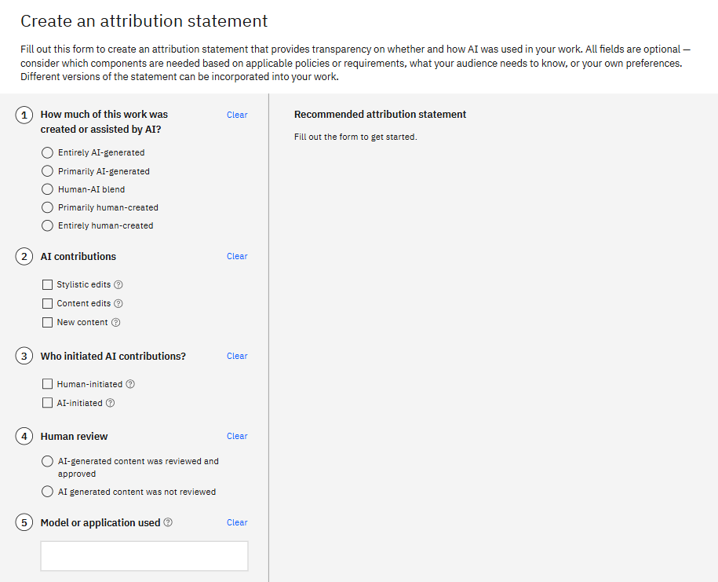

# AI Attribution Toolkit

AI Attribution Toolkit is a research prototype designed to support transparent, nuanced disclosure of how generative AI systems contribute to creative and knowledge work. The project was motivated by the observation that existing attribution and authorship conventions, such as citations, credits, or licenses, are poorly suited to describing collaborative workflows in which humans and AI systems jointly produce an artifact. As generative AI tools become embedded in professional and creative practice, simple statements such as “AI was used” fail to communicate meaningful information about agency, responsibility, and human oversight.

Using the AI Attribution Toolkit as a design probe, we explored how structured reflection and guided questioning might help creators articulate what role AI played, what decisions remained human, and how the final output was reviewed and approved. Rather than attempting to automatically infer attribution, the toolkit centers human judgment and self reporting as a first step toward responsible disclosure.

The toolkit takes the form of an interactive, questionnaire driven framework that guides users through a series of prompts about their creative process. These prompts cover dimensions such as the type of AI system used, the nature and scope of AI contributions, the degree of human modification or curation, and the locus of final accountability. Based on the user's responses, the system generates a standardized AI attribution statement that can be attached to a piece of work, much like a credit line or disclosure note.

<figure>
  
  <figcaption>
    The toolkit provides a set of questions to help users clarify how AI contributed to their creative process.
  </figcaption>
</figure>

Conceptually, the AI Attribution Toolkit draws inspiration from established systems such as Creative Commons licenses and the CRediT contributor role taxonomy, while intentionally avoiding legal or compliance oriented framing. Instead, the project positions attribution as a communicative practice, a way of fostering trust, accountability, and shared understanding between creators and audiences in AI mediated work.

Through its design, the project contributes to broader conversations around human-AI collaboration, responsible AI practices, and the social infrastructure needed to support transparent use of generative models in creative and professional domains.

## Prerequisites

This project uses **Node.js**. To ensure you are using the correct version, we recommend using [nvm](https://github.com/nvm-sh/nvm).

1.  Navigate to the project directory.
2.  Run `nvm use` to select the Node.js version specified in the `.nvmrc` file.

## Environment Variables

This project requires certain environment variables to be set. You can find a template in `.env.example`.

1.  Copy `.env.example` to a new file named `.env`.
2.  Fill in the values for the following variables:
    *   `PUBLIC_UMAMI_SRC`: URL for the Umami analytics script.
    *   `PUBLIC_UMAMI_WEBSITE_ID`: Your Umami website ID.

Note: These variables are not critical for running the application and can be set to an empty string (`''`).

## Developing

Once you've installed dependencies with `npm install` (or `pnpm install` or `yarn`), start a development server:

```bash
npm run dev

# or start the server and open the app in a new browser tab
npm run dev -- --open
```

## Building

To create a production version of your app:

```bash
npm run build
```

You can preview the production build with `npm run preview`.

## Testing

This project uses [Vitest](https://vitest.dev/) for unit testing and [Cypress](https://www.cypress.io/) for end-to-end testing.

### Unit Tests

Run unit tests with:

```bash
npm run test
```

### End-to-End Tests

Run end-to-end tests with:

```bash
npm run test:e2e
```

## 📜 License  

AI Attribution Toolkit is licensed under the [Apache License 2.0](https://www.apache.org/licenses/LICENSE-2.0).  
